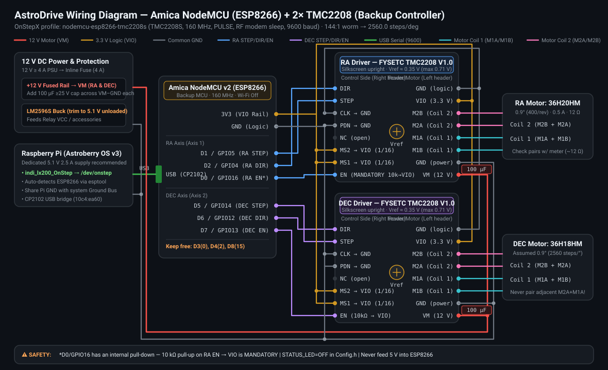
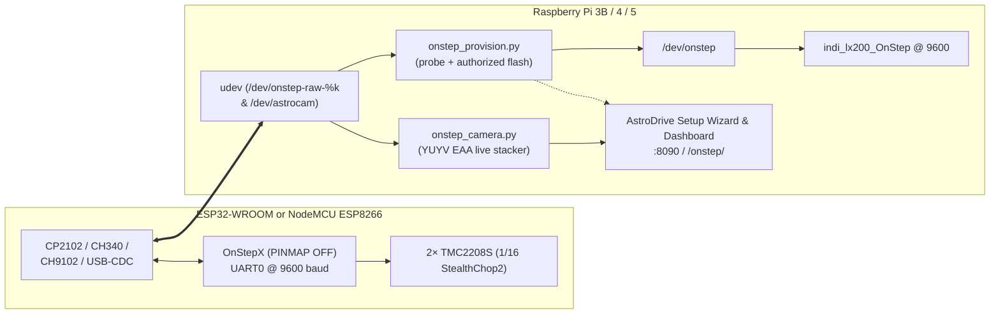

# AstroDrive

Turn a **Raspberry Pi** + **ESP32-WROOM** (or **NodeMCU ESP8266**) + **2× silent TMC2208** stepper drivers into a plug-and-play **OnStepX** telescope mount controller with a built-in browser **Setup Wizard**.

---

## Quick Start (4 Simple Steps)

No manual firmware compiling, no config file editing, and no memorizing Linux commands. After pasting **one** install line, everything else is **Next → Next → Done** in your browser.

### What You Need
- **Raspberry Pi 3B, 4, or 5** + **≥ 16 GB microSD card** + good **5.1 V / 2.5 A+** Pi power supply
- **ESP32-WROOM** *(recommended)* or **NodeMCU ESP8266** + a short **data USB cable**
- **2× TMC2208** stepper drivers, **2× stepper motors** (`36H20HM` / `36H18HM`), **12 V ≥ 4 A** power supply + **4 A fuse**, **2× 100 µF** capacitors, **2× 10 kΩ** resistors, and a multimeter
- *(Optional)* **USB UVC webcam** (e.g., disassembled Logitech USB webcam) for live camera preview & EAA stacking

---

### Step 1 — Flash the microSD Card

- **On Raspberry Pi 4 or 5 (Astroberry OS):**
  1. Download **Astroberry OS** (`astroberryos_3.2_debian-trixie-arm64.img.xz`) from **[astroberry.io/download](https://astroberry.io/download/)**.
  2. Open **[Raspberry Pi Imager](https://www.raspberrypi.com/software/)**, pick your Pi model, pick **Use custom** → the file you downloaded, pick your microSD card, click **Next**, and click **No** to OS customisation (Astroberry sets itself up automatically).
- **On Raspberry Pi 3 Model B (Raspberry Pi OS 64-bit):**
  1. Open **[Raspberry Pi Imager](https://www.raspberrypi.com/software/)**, choose **Raspberry Pi 3**, choose **Raspberry Pi OS (64-bit)**, and pick your microSD card.
  2. Click **Next** → **Edit Settings** to enter your **home Wi-Fi** and enable **SSH**, then flash and eject the card.

---

### Step 2 — Turn On the Pi & Connect to Home Wi-Fi

1. Insert the microSD card into the Raspberry Pi and plug in its power. Wait **2 minutes**.
2. **Astroberry OS (Pi 4/5):** join Wi-Fi **`astroberry`** (password **`astroberry`**), open **`http://astroberry.local`** (login **`astroberry`** / **`astroberry`**), and follow its short welcome screen to join your **home Wi-Fi**.
3. **Raspberry Pi OS (Pi 3B):** your Pi joins your home Wi-Fi automatically using the settings from Step 1.

---

### Step 3 — Install AstroDrive (One Command)

1. Open the **Terminal** on the Pi (or SSH into it from your laptop).
2. Copy and paste this single line, then press **Enter**:

```bash
curl -fsSL https://raw.githubusercontent.com/0denko/AstroDrive/main/setup.sh | sudo bash
```

3. Wait **3–5 minutes** until you see **`AstroDrive is installed and ready!`** *(if the Pi has no internet yet, it will clearly warn that firmware wasn't downloaded and tell you how to retry)*.
   - This automatically installs AstroDrive, the USB webcam & EAA live-stacking service, downloads the latest CI-built OnStepX firmware for both ESP32 and NodeMCU (SHA-256 checked against the release manifest), pre-configures KStars/Ekos (`LX200 OnStep` on `/dev/onstep` at `9600` baud), enables safe daily background updates (opt-out), and prints your personal **Setup Wizard link** (which includes your Setup PIN).
   - You can close the Terminal after copying or clicking the link!

---

### Step 4 — Click Through the Setup Wizard in Your Browser

1. Open the **Setup Wizard link** printed at the end of Step 3 (`http://astroberry.local/onstep/#token=...`, or `http://<pi-hostname>.local:8090/#token=...` — the `#token` fragment stays inside your browser and is never written to server logs).
   - *(If you open `http://astroberry.local` later without the link, click **`AstroDrive Setup`** in the bottom-right corner and paste the Setup PIN from `/etc/onstep-autoprovision/webui.token` once.)*
2. Click **Next →** through the 5 guided screens:

| Screen | What You Do |
| :--- | :--- |
| **1. System Check** | Confirm the green checkmarks (Pi power, downloaded firmware, web UI / overlay, KStars/Ekos defaults, AstroDrive version). Fix any yellow/red item with one click, then click **Next**. |
| **2. Wi-Fi & Field Hotspot** *(optional)* | Choose a hotspot name & password (8+ characters) if you want the Pi to create its own Wi-Fi out under dark skies, click **Save**, then **Next** (or skip). |
| **3. Flash Board** | Plug your **bare** ESP32 or NodeMCU into any Pi USB port (no 12 V or motors yet). Click **⚡ Flash OnStepX to This Board** — wait ~30–60 seconds for the green **Controller Ready!** message, then click **Next**. *(Unrelated USB accessories are never overwritten automatically.)* |
| **4. Wiring & Safety** | Unplug USB, pick your board to view the wiring picture right on screen, tick off the 6 safety checks (including setting `Vref ≈ 0.35 V` with motors unplugged), and turn on **12 V power before plugging USB back in**. Click **Next**. |
| **5. Connect & Finish** | Open **KStars → Ekos**, pick **Mount: `LX200 OnStep`**, click **Start** → **Connect**, and test moving the motors on your desk before mounting them on the telescope! |

> **Tip for dark-sky trips (no internet):** If you configured a field hotspot in Wizard Screen 2, join that hotspot on your phone when away from home Wi-Fi, open `http://10.42.0.1/onstep/` (or `http://10.42.0.1:8090/`), and tap **Sync Pi Clock from This Phone/Laptop** so your mount has the exact time.

---

## USB Camera & Live Stacking (EAA)

USB webcam support is **installed automatically** — just plug any standard USB UVC webcam (such as a disassembled Logitech webcam) into the Pi and open the **Dashboard** tab in AstroDrive:

1. Tap **🔒 Lock Auto Controls** to turn off auto-exposure, auto-gain, auto-white-balance, and autofocus.
2. Adjust exposure/gain under **Webcam Hardware Controls (V4L2)** and tune the **Asinh EAA Stretch** slider.
3. Choose **Dynamic Non-Tracking** (follows continuous drift & auto-resets if you bump the mount) or **Fixed Reference** (sigma-clipped deep stack with drift prompt), pick **Keep Best 25–100%** to reject blurry or cloudy frames automatically, and click **💾 Save PNG** to download your stacked image.

*(Tuned for Raspberry Pi 3B at `640×480` YUYV in RAM/tmpfs with zero per-frame microSD wear, idles silently when no webcam is plugged in, and steps aside automatically whenever INDI `indi_v4l2_ccd` is using the camera.)*

---

## Quick Troubleshooting

| Problem | Easy Fix |
| :--- | :--- |
| **Board isn't detected or won't flash** | Use a short **data-capable** USB cable (some charging cables have no data wires). On some ESP32 boards, hold the tiny **BOOT** button for 2 seconds right after plugging it in. |
| **Red "Low Raspberry Pi power" warning** | Power the Pi from its own dedicated **5.1 V / 2.5 A+** adapter (not a phone charger or thin USB cable). |
| **Motor buzzes and gets warm instead of turning** | Power off and check the 4 motor wires — pair Coil 1 to `M1A`+`M1B` and Coil 2 to `M2A`+`M2B` (never pair the two middle `M2A`+`M1A` pins together). |
| **Telescope moves twice as far as commanded** | Make sure both `MS1` and `MS2` on each TMC2208 are wired to `VIO` (3.3 V) for 1/16 microsteps. |
| **Can't reach `http://astroberry.local`** | Try `http://<pi-hostname>.local:8090` (or `http://10.42.0.1:8090` when connected to the field hotspot). |
| **USB camera says "held by INDI"** | Disconnect the `V4L2 CCD` driver in KStars/Ekos when using AstroDrive's built-in live stacker (only one program can own `/dev/video0` at a time). |

---

## Wiring Diagrams

Full step-by-step wiring tables, motor measurements, and power notes are in **[`HARDWARE.md`](HARDWARE.md)**.

### ESP32-WROOM + 2× TMC2208 (Recommended Primary)


### NodeMCU ESP8266 + 2× TMC2208 (Drop-In Backup)



---

## Technical Reference (For Advanced Users)

<details>
<summary><strong>Pinout Table &amp; Motor Settings</strong></summary>

All pin assignments in both firmware profiles match [`HARDWARE.md`](HARDWARE.md) directly:

| Signal | ESP32-WROOM (Primary) | NodeMCU ESP8266 (Backup) | TMC2208 Pin | Notes |
| :--- | :---: | :---: | :---: | :--- |
| **RA STEP** | `GPIO25` | `D1` (`GPIO5`) | RA `STEP` | Boot-safe |
| **RA DIR** | `GPIO26` | `D2` (`GPIO4`) | RA `DIR` | Boot-safe |
| **RA ENABLE** | `GPIO27` | `D0` (`GPIO16`) | RA `EN` | Active LOW — fit **10 kΩ pull-up to `VIO`** (mandatory on NodeMCU `D0`!) |
| **DEC STEP** | `GPIO14` | `D5` (`GPIO14`) | DEC `STEP` | Boot-safe |
| **DEC DIR** | `GPIO12` | `D6` (`GPIO12`) | DEC `DIR` | On ESP32, `GPIO12` is a strapping pin (**no external pull-up!**) |
| **DEC ENABLE** | `GPIO13` | `D7` (`GPIO13`) | DEC `EN` | Active LOW — fit **10 kΩ pull-up to `VIO`** |
| **Logic VCC / GND** | `3V3` / `GND` | `3V3` / `GND` | `VIO` / logic `GND` | **Never feed 5 V into ESP32/ESP8266 pins** |
| **Driver Tie-Offs** | — | — | `MS1`, `MS2` → `VIO`; `PDN`, `CLK` → `GND` | Selects `1/16` StealthChop2 (256× interpolated) + internal clock + standstill power-down |

- **Motors:** `36H20HM-0504A` (`0.9°` = `400` steps/rev, `0.5 A`, `12 Ω`) on RA and `36H18HM` on DEC; at `1/16` microsteps and `144:1` worm → **`2560.0` steps/degree** (if `36H18HM` is `1.8°`, adjust `AXIS2_STEPS_PER_DEGREE` to `1280.0`).
- **TMC2208 `Vref`:** Set to **`~0.35 V`** (`~0.25 A RMS`) with motors unplugged; never exceed **`0.71 V`** (`0.50 A`).

</details>

<details>
<summary><strong>How Auto-Provisioning &amp; Live Stacking Work (Architecture)</strong></summary>

1. **`udev`** (`udev/99-onstep-nodemcu.rules`) detects CP2102 (`10c4:ea60`), CH340 (`1a86:7523`), CH9102 (`1a86:55d4`), and Espressif native USB-CDC (`303a:1001`) boards, creates per-device `/dev/onstep-raw-%k` symlinks, blocks `ModemManager` (`ID_MM_DEVICE_IGNORE=1`), and triggers `onstep-autoprovision@<dev>.service`.
2. **`systemd` + Python** (`scripts/onstep_provision.py`) acquires an exclusive `flock`, verifies no active INDI session holds the port, probes LX200 `:GVP#` / `:GVN#` without DTR/RTS reset, and **atomically publishes `/dev/onstep`** for `indi_lx200_OnStep`. Blank boards are only flashed when explicitly authorized from the Setup Wizard (single-use ticket + USB allowlist recording) or when `AUTO_FLASH="true"` is intentionally enabled.
3. **USB Camera & EAA Stacker** (`scripts/onstep_camera.py`, `systemd/onstep-camera.service`, `udev/99-onstep-camera.rules`) binds `/dev/astrocam`, captures uncompressed YUYV frames at `640×480` (Pi 3B baseline, `MemoryMax=350M`, `Nice=5`), grades sharpness (star FWHM / blurred-Laplacian + rolling Keep Best % + cloud collapse guard), aligns continuous drift via binned phase correlation (`dynamic_drift` or sigma-clipped `fixed_ref`), and writes display previews atomically to tmpfs (`/run/onstep-camera/preview.jpg`) served only over authenticated `X-AstroDrive-Token` endpoints.
4. **Authenticated Web UI overlay & self-updates:** Nginx proxies `/onstep/` to `onstep-webui.service` (`127.0.0.1:8090`, hardened with `ProtectSystem=strict` and Setup PIN authentication via `/etc/onstep-autoprovision/webui.token` on all mutating and camera routes) and injects `/onstep/overlay.js` via `sub_filter` with an APT post-invoke hook (`/etc/apt/apt.conf.d/99-onstep-nginx-overlay`). Daily timers (`onstep-firmware-update.timer` and `astrodrive-update.timer`, opt-out via `AUTO_UPDATE_SOFTWARE`) keep firmware cache and AstroDrive scripts current when online and idle.



</details>

<details>
<summary><strong>Alternative Installs (Skip Camera, On-Pi Compiler, Pre-baked CI Image)</strong></summary>

- **Skip USB camera / OpenCV packages** (minimal mount-only install):
  ```bash
  curl -fsSL https://raw.githubusercontent.com/0denko/AstroDrive/main/setup.sh | sudo bash -s -- --without-camera
  ```
- **Enable on-Pi OnStepX compilation** (installs SHA-256-verified `arduino-cli v1.6.0`; only needed if you edit `Config.h` directly on the Pi):
  ```bash
  curl -fsSL https://raw.githubusercontent.com/0denko/AstroDrive/main/setup.sh | sudo bash -s -- --with-arduino-cli
  ```
- **Pre-baked downloadable `.img.xz`:** Run **Actions → Build Raspberry Pi Overlay Image (.img.xz) → Run workflow** in GitHub Actions to generate a ready-to-flash `.img.xz` with AstroDrive + firmware baked in.
- **Automated Firmware Builds:** `.github/workflows/build-firmware.yml` compiles both `nodemcu-esp32-tmc2208s` (`esp32:esp32@2.0.17`) and `nodemcu-esp8266-tmc2208s` (`esp8266:esp8266@3.1.2` + `esp8266RfOff` plugin) against the pinned OnStepX commit in `firmware/onstepx.ref` and publishes `.bin` + SHA-256 manifests to [GitHub Releases](https://github.com/0denko/AstroDrive/releases/latest).

</details>

<details>
<summary><strong>Repository Layout &amp; CLI Diagnostics</strong></summary>

```text
AstroDrive/
├── LICENSE                                # GNU GPLv3 (from v1.3.0 onward)
├── CHANGELOG.md                           # Release notes & license history
├── VERSION                                # AstroDrive software version (used by self-updater)
├── setup.sh                               # One-line curl | sudo bash bootstrap installer
├── install.sh                             # Idempotent RPi installer (--with-camera, --with-arduino-cli, --chroot)
├── HARDWARE.md                            # Full motor, power, Vref, and wire-by-wire guide
├── docs/                                  # ESP32 & NodeMCU ESP8266 SVG wiring schematics
├── .github/workflows/                     # Automated firmware builds, lint/smoke tests & Pi .img.xz builder
├── webui/                                 # Token-authenticated Setup Wizard, EAA Dashboard & Astroberry overlay (:8090)
├── scripts/                               # Provisioner, EAA camera daemon, INDI defaults, hotspot, updaters
├── systemd/ udev/ nginx/ config/          # Hardened units/timers, udev rules, Nginx overlay, config template
└── firmware/                              # Pinned onstepx.ref + ESP32/ESP8266 TMC2208S OnStepX profiles
```

```bash
# View your Setup Wizard PIN
sudo cat /etc/onstep-autoprovision/webui.token

# Watch live provisioning, camera, or update logs
journalctl -fu 'onstep-autoprovision@*' -u onstep-camera.service

# Non-resetting LX200 handshake check
/opt/onstep-autoprovision/.venv/bin/python \
  /opt/onstep-autoprovision/scripts/probe_onstep.py --device /dev/onstep

# Refresh cached firmware binaries or check for AstroDrive software updates
sudo /opt/onstep-autoprovision/scripts/update_firmware.sh --all
sudo /opt/onstep-autoprovision/scripts/update_software.sh --force
```

</details>

---

## License

AstroDrive is free and open-source software licensed under the **GNU General Public License v3.0 (GPLv3)** starting from `v1.3.0` onward — see [`LICENSE`](LICENSE) and [`CHANGELOG.md`](CHANGELOG.md) for details.

