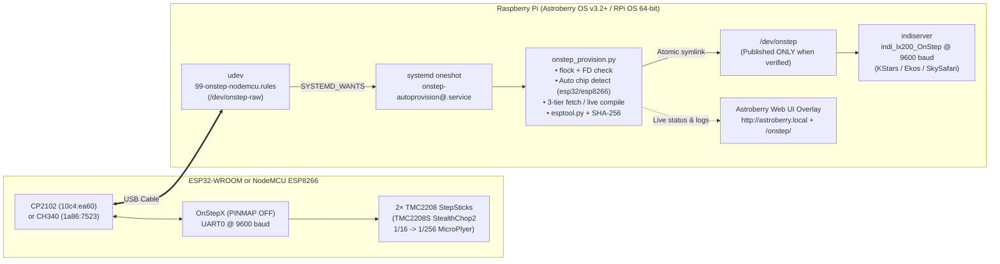
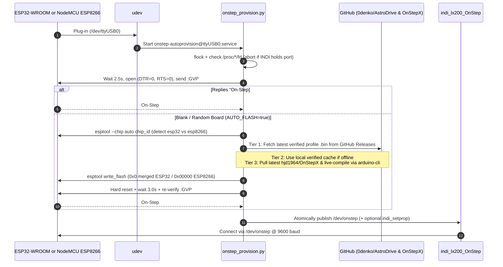

# AstroDrive

Automated **OnStepX** firmware provisioning, **Astroberry OS v3.2+ Web UI overlay**, and **INDI (`indi_lx200_OnStep`)** integration for a Raspberry Pi telescope mount controller driving **ESP32-WROOM** (primary) or **NodeMCU ESP8266** (backup) + **2× silent TMC2208** stepper drivers.

> Detailed motor specs, LM2596S 5.1 V cable-drop measurements, undervoltage diagnostics, power sequencing, and wire-by-wire build checklists live in **[`HARDWARE.md`](HARDWARE.md)**.

---

## Architecture Overview

To eliminate `udev` timeouts and prevent serial-port races with `indi_lx200_OnStep`, `ModemManager`, and `gpsd`, device readiness is split into two stages:

1. **`udev`** (`udev/99-onstep-nodemcu.rules`) detects CP2102 (`10c4:ea60`) or CH340 (`1a86:7523`) NodeMCU / ESP32 boards, creates `/dev/onstep-raw`, blocks `ModemManager` (`ID_MM_DEVICE_IGNORE=1`), and triggers `onstep-autoprovision@ttyUSBx.service`.
2. **`systemd` + Python** (`scripts/onstep_provision.py`) acquires an exclusive `flock`, verifies no active INDI session holds the port, probes LX200 `:GVP#` / `:GVN#` without triggering DTR/RTS auto-reset, auto-detects any blank board's MCU silicon (`esp32` vs `esp8266`), fetches or live-compiles the matching OnStepX `.bin`, flashes & verifies it, and **only then atomically publishes `/dev/onstep`** for `indi_lx200_OnStep`.



### Hot-Plug, Auto-Detect & 3-Tier Firmware Resolution



---

## Hardware & Wiring Diagrams

### ESP32-WROOM + 2× TMC2208 (Recommended Primary)


### NodeMCU ESP8266 + 2× TMC2208 (Drop-In Backup)


All pin assignments in both firmware profiles match [`HARDWARE.md`](HARDWARE.md) directly:

| Signal | ESP32-WROOM (Primary) | NodeMCU ESP8266 (Backup) | TMC2208 Pin | Notes |
| :--- | :---: | :---: | :---: | :--- |
| **RA STEP** | `GPIO25` | `D1` (`GPIO5`) | RA `STEP` | Boot-safe |
| **RA DIR** | `GPIO26` | `D2` (`GPIO4`) | RA `DIR` | Boot-safe |
| **RA ENABLE** | `GPIO27` | `D0` (`GPIO16`) | RA `EN` | Active LOW — fit **10 kΩ pull-up to `VIO`** (mandatory on NodeMCU `D0`!) |
| **DEC STEP** | `GPIO14` | `D5` (`GPIO14`) | DEC `STEP` | Boot-safe |
| **DEC DIR** | `GPIO12` | `D6` (`GPIO12`) | DEC `DIR` | On ESP32, `GPIO12` is a strapping pin (**no external pull-up!**) |
| **DEC ENABLE** | `GPIO13` | `D7` (`GPIO13`) | DEC `EN` | Active LOW — fit **10 kΩ pull-up to `VIO`** |
| **Logic VCC / GND** | `3V3` / `GND` | `3V3` / `GND` | `VIO` / logic `GND` | **Never feed 5 V into ESP32/ESP8266 pins** |
| **Driver Tie-Offs** | — | — | `MS1`, `MS2` → `VIO`; `PDN`, `CLK` → `GND` | Selects `1/16` StealthChop2 (256× interpolated) + internal clock + standstill power-down |

- **Motors (`HARDWARE.md`):** `36H20HM-0504A` (`0.9°` = `400` steps/rev, `0.5 A`, `12 Ω`) on RA and `36H18HM` on DEC; at `1/16` microsteps (`MS1` + `MS2` → `VIO`) and `144:1` worm → **`2560.0` steps/degree**.
- **TMC2208 `Vref`:** Start at **`~0.35 V`** (`~0.25 A RMS`, cool & plenty of torque at 144:1); never exceed **`0.71 V`** (`0.50 A` motor rating). Tune with motors disconnected and `100 µF` capacitors across `VM` and `GND`.

---

## Repository Layout

```text
AstroDrive/
├── HARDWARE.md                            # Complete motor, power, Vref, and wire-by-wire guide
├── docs/
│   ├── wiring-esp32-tmc2208.svg           # Full schematic: ESP32-WROOM + 2× TMC2208
│   └── wiring-nodemcu-esp8266-tmc2208.svg # Full schematic: NodeMCU ESP8266 + 2× TMC2208
├── .github/workflows/
│   ├── build-firmware.yml                 # Weekly/on-demand OnStepX overlay compiler -> Releases
│   └── build-pi-image.yml                 # Upstream Astroberry / RPi OS + overlay -> .img.xz
├── install.sh                             # Idempotent RPi installer (--with-arduino-cli, --chroot)
├── requirements.txt                       # Pinned esptool 4.x + pyserial
├── config/
│   └── onstep-autoprovision.env.example   # TARGET_CHIP=auto, GITHUB_REPO=0denko/AstroDrive
├── udev/
│   └── 99-onstep-nodemcu.rules            # CP2102 & CH340 rules + ModemManager ignore
├── systemd/
│   ├── onstep-autoprovision@.service      # Async templated oneshot unit (15-min compile timeout)
│   ├── onstep-firmware-update.service     # Online GitHub Release firmware cache refresher
│   ├── onstep-firmware-update.timer       # Daily background check (skips cleanly offline)
│   └── onstep-webui.service               # Local Web UI & Astroberry overlay backend (:8090)
├── nginx/
│   └── onstep-astroberry-overlay.conf     # Proxies /onstep/ & injects overlay.js into Astroberry UI
├── webui/
│   ├── onstep_webui.py                    # Zero-dependency REST API & dashboard server
│   ├── index.html                         # Mobile-first dark / night-vision provisioning UI
│   └── overlay.js                         # Upgrade-safe status pill & slide-out drawer for Astroberry
├── scripts/
│   ├── onstep_provision.py                # Auto chip detect, 3-tier fetch/compile, flash & symlink
│   ├── probe_onstep.py                    # Standalone LX200 :GVP# / :GVN# diagnostic CLI
│   ├── update_firmware.sh                 # Pulls latest verified .bin + manifest from Releases
│   ├── setup_hotspot.sh                   # NetworkManager Home Wi-Fi + Dark-Sky Hotspot fallback
│   └── configure_nginx_overlay.sh         # Idempotent Nginx overlay attach + APT upgrade hook
└── firmware/
    ├── README.md                          # TMC2208S jumper microstepping & Vref guide
    ├── build.sh                           # Multi-profile arduino-cli builder (--profile / --all)
    ├── platformio.ini                     # Optional PlatformIO config (nodemcuv2)
    ├── Config.h -> profiles/nodemcu-esp32-tmc2208s/Config.h
    ├── Extended.config.h -> profiles/nodemcu-esp32-tmc2208s/Extended.config.h
    └── profiles/
        ├── nodemcu-esp32-tmc2208s/        # ESP32-WROOM + 2× TMC2208S (pins 25/26/27, 14/12/13)
        └── nodemcu-esp8266-tmc2208s/      # NodeMCU ESP8266 + 2× TMC2208S (pins 5/4/16, 14/12/13)
```

---

## Astroberry Web UI Overlay (Built-In)

`install.sh` (and the CI `.img.xz` builder) automatically integrates AstroDrive directly into **Astroberry OS v3.2+'s** web interface at **`http://astroberry.local`**:

- **Upgrade-safe:** Nginx proxies `/onstep/` to `onstep-webui.service` (`127.0.0.1:8090`) and injects `/onstep/overlay.js` via `sub_filter` — zero `astroberry-manager` package files are modified, and an APT post-invoke hook (`/etc/apt/apt.conf.d/99-onstep-nginx-overlay`) preserves the overlay across `apt upgrade`.
- **On your phone:** Open `http://astroberry.local` — a live **OnStepX** status pill (`Ready` / `Provisioning…` / `INDI Active`) opens a night-vision drawer with live compile/flash logs, `:GVP#`/`:GVN#` probe, online release fetch, and `AUTO_FLASH`/`AUTO_UPGRADE` toggles.
- **Standalone fallback (vanilla RPi OS):** Also always reachable at **`http://<pi-hostname>.local:8090/`**.

---

## Upstream + Overlay CI Pipelines (Downloadable `.img.xz`)

1. **Automated Firmware Builds (`.github/workflows/build-firmware.yml`):**
   - Pulls latest upstream `hjd1964/OnStepX` weekly (or on push / manual trigger), compiles both ESP8266 and ESP32 profiles with `arduino-cli`, and publishes verified `.bin` + `manifest-<profile>.json` files to **GitHub Releases**.
2. **Downloadable Ready-to-Flash SD Card Image (`.github/workflows/build-pi-image.yml`):**
   - Run **Actions → Build Raspberry Pi Overlay Image → Run workflow** with the latest **Astroberry OS v3.2+** or **Raspberry Pi OS 64-bit** `.img.xz` URL.
   - Publishes **`astrodrive-pi-YYYY.MM.DD.img.xz`** + `.sha256` to GitHub Releases ready for **Raspberry Pi Imager**.

---

## Manual Raspberry Pi Installation & Phone Setup

```bash
sudo apt update && sudo apt install -y python3 python3-venv python3-pip git curl udev
sudo ./install.sh --with-arduino-cli --enable-auto-flash --github-repo "0denko/AstroDrive"
```

### Home Wi-Fi + Automatic Dark-Sky Hotspot Fallback

```bash
sudo /opt/onstep-autoprovision/scripts/setup_hotspot.sh \
  --home-ssid "YourHomeWiFi" --home-pass "YourHomePassword" \
  --ap-ssid "AstroPi-OnStep" --ap-pass "clearSkies2026"
```

- **At home:** Connects to `YourHomeWiFi` automatically (enabling online GitHub Release fetches & live OnStepX compiles).
- **In the field:** Automatically broadcasts `AstroPi-OnStep` (`10.42.0.1`). Join on your phone and open `http://astroberry.local` (or connect **SkySafari** to `10.42.0.1:9624` via the `indi_skysafari` driver).

### INDI Driver Configuration (`indi_lx200_OnStep`)

- **Mount Driver:** `LX200 OnStep` (`indi_lx200_OnStep`)
- **Mode:** `Serial` | **Port:** `/dev/onstep` | **Baud Rate:** `9600` | **Auto Search:** `Disabled`

---

## Diagnostics

```bash
# Live auto-detection, online fetch / live compile, and flashing logs
journalctl -fu 'onstep-autoprovision@*'

# Non-resetting LX200 handshake check
/opt/onstep-autoprovision/.venv/bin/python \
  /opt/onstep-autoprovision/scripts/probe_onstep.py --device /dev/onstep

# Refresh cached binaries from GitHub Releases
sudo /opt/onstep-autoprovision/scripts/update_firmware.sh --all
```
