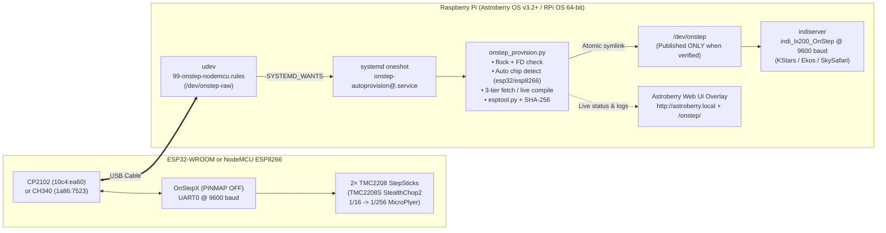
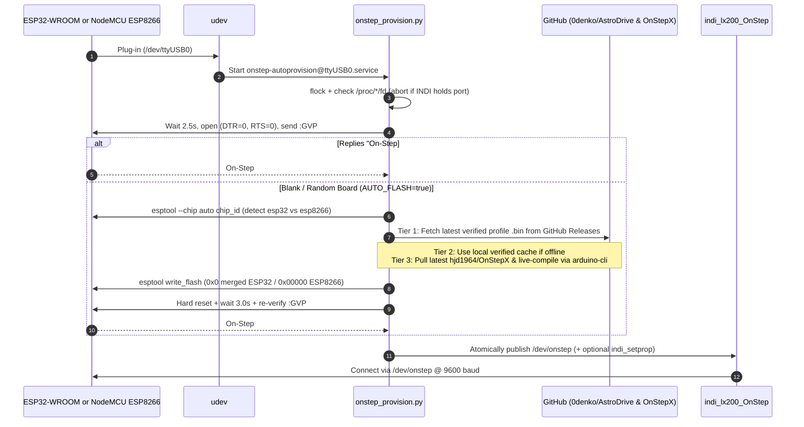

# AstroDrive

Automated **OnStepX** firmware provisioning, **Astroberry OS v3.2+ Web UI overlay**, and **INDI (`indi_lx200_OnStep`)** integration for a Raspberry Pi telescope mount controller driving **ESP32-WROOM** (primary) or **NodeMCU ESP8266** (backup) + **2× silent TMC2208** stepper drivers.

> Detailed motor specs, LM2596S 5.1 V cable-drop measurements, undervoltage diagnostics, power sequencing, and wire-by-wire build checklists live in **[`HARDWARE.md`](HARDWARE.md)**.

---

## Step-by-Step Setup Guide (Fresh SD Card → Working Mount)

Follow these steps in order. You can complete **Steps 1–5 on your desk** with just the Raspberry Pi and a bare ESP32/NodeMCU over USB before wiring the 12 V supply, TMC2208 drivers, and stepper motors in **Step 6**.

### What You Need

- **Raspberry Pi 4 or 5** (64-bit) with a **≥ 16 GB microSD card** and a dedicated **5.1 V / 2.5 A+** power supply (Pi 3B also works with vanilla 64-bit Raspberry Pi OS).
- **ESP32-WROOM / NodeMCU-32S** (recommended primary) **or** **Amica NodeMCU v2 ESP8266** (backup), plus a **short, thick data-capable USB cable**.
- **2× FYSETC TMC2208 V1.0** stepper drivers + **2× 100 µF (≥ 25 V)** electrolytic capacitors + **2× 10 kΩ** resistors (for `EN` pull-ups).
- **Stepper motors & power:** `36H20HM-0504A` (RA), `36H18HM` (DEC), **12 V ≥ 4 A DC supply** with a **4 A inline fuse**, and a multimeter.

---

### Step 1 — Flash the microSD Card

1. Download the latest 64-bit **Astroberry OS v3.2+** image (`astroberryos_3.2_debian-trixie-arm64.img.xz`) from **[astroberry.io/download](https://astroberry.io/download/)**.
2. Open **Raspberry Pi Imager**:
   - **Raspberry Pi Device:** select your Pi model.
   - **Operating System:** click **Use custom** and select the downloaded `.img.xz` file.
   - **Storage:** select your microSD card.
3. Click **Next**. When Raspberry Pi Imager asks *"Would you like to apply OS customisation settings?"*, click **No** — Astroberry OS configures itself on first boot and customisation settings can interfere with it.
4. Wait for the write and verification to finish, then eject the card.

> **Alternative (Raspberry Pi 3B or vanilla Raspberry Pi OS 64-bit):** Flash **Raspberry Pi OS (64-bit)** with Raspberry Pi Imager, **do** apply OS Customisation (set username, password, Wi-Fi, and enable SSH), then jump to Step 3. Without Astroberry OS, AstroDrive's Web UI runs standalone at `http://<hostname>.local:8090`, and you'll install INDI/KStars separately.
>
> **Alternative (Pre-baked CI `.img.xz`):** You can also trigger **Actions → Build Raspberry Pi Overlay Image (.img.xz)** in this repo to produce a ready-to-flash image with AstroDrive already installed.

---

### Step 2 — First Boot & Connect the Pi to Home Wi-Fi

1. Insert the microSD card into the Raspberry Pi and power it on. Wait **1–2 minutes** for first boot.
2. Connect your laptop or phone to the Pi in one of two ways:
   - Plug the Pi into your router with an **Ethernet cable**, **or**
   - Join the temporary Wi-Fi hotspot named **`astroberry`** (password: **`astroberry`**).
3. Open **`http://astroberry.local`** in your browser.
4. Accept the welcome screen and log in with username **`astroberry`** and password **`astroberry`**.
5. Inside Astroberry's initial setup:
   - Set your **WLAN country** (required for Wi-Fi).
   - Set your **geographic location**.
   - Connect the Pi to your **home Wi-Fi** (or keep Ethernet plugged in) so the Pi gets internet access and syncs its system clock.
6. *(Recommended)* Change the default password by opening a terminal and running `passwd`.

---

### Step 3 — Install AstroDrive on the Pi

SSH into the Pi (`ssh astroberry@astroberry.local`) or open the terminal inside Astroberry's web desktop, then run:

```bash
sudo apt update && sudo apt install -y python3 python3-venv python3-pip git curl udev
git clone https://github.com/0denko/AstroDrive.git
cd AstroDrive
sudo ./install.sh --enable-auto-flash --github-repo "0denko/AstroDrive"
```

Then pre-download the latest verified OnStepX firmware binaries (ESP32 + ESP8266) from GitHub Releases so they are cached locally even when you go offline in the field:

```bash
sudo /opt/onstep-autoprovision/scripts/update_firmware.sh --all
```

> **Note:** You do **not** need `--with-arduino-cli` for normal use — both `nodemcu-esp32-tmc2208s` and `nodemcu-esp8266-tmc2208s` binaries are prebuilt by GitHub Actions and downloaded automatically. Add `--with-arduino-cli` only if you want the Pi itself to compile custom `Config.h` edits on-device (takes ~10 minutes and ~1.5 GB of SD space).

Verify the Web UI overlay is live by reloading **`http://astroberry.local`** — you should see an **OnStepX** status pill in the corner (or open **`http://astroberry.local:8090`** directly).

---

### Step 4 — Set Up Home Wi-Fi + Dark-Sky Field Hotspot (Recommended)

Configure NetworkManager so the Pi uses your home Wi-Fi at home and automatically falls back to its own hotspot (`10.42.0.1`) at dark-sky sites:

```bash
sudo /opt/onstep-autoprovision/scripts/setup_hotspot.sh \
  --home-ssid "YourHomeWiFi" --home-pass "YourHomePassword" \
  --ap-ssid "AstroPi-OnStep" --ap-pass "clearSkies2026"
```

- **At home:** Connects to `YourHomeWiFi` automatically (priority `100`).
- **In the field:** Broadcasts `AstroPi-OnStep` (priority `10`, IP `10.42.0.1`). Join it on your phone and open `http://astroberry.local` or `http://10.42.0.1`.

---

### Step 5 — Plug In the ESP32 / NodeMCU (Automatic Firmware Flash)

Do this **on your desk with the bare microcontroller first** (no 12 V power, drivers, or motors attached yet):

1. Open a live log view on the Pi so you can watch the auto-flasher work:
   ```bash
   journalctl -fu 'onstep-autoprovision@*'
   ```
   *(Or open `http://astroberry.local` and click the **OnStepX** status pill.)*
2. Plug your **ESP32-WROOM** (or **NodeMCU ESP8266**) into a USB port on the Pi using a **short, thick data USB cable**.
3. Wait **30–60 seconds**. AstroDrive automatically:
   - Detects the CP2102 (`10c4:ea60`) or CH340 (`1a86:7523`) USB-serial chip,
   - Identifies whether it is an `esp32` or `esp8266` via `esptool`,
   - Flashes the matching verified OnStepX `TMC2208S` binary (`onstepx-nodemcu-esp32-tmc2208s.bin` or `onstepx-nodemcu-esp8266-tmc2208s.bin`),
   - Resets the board, verifies the `:GVP#` LX200 handshake, and publishes **`/dev/onstep`**.
4. Confirm `/dev/onstep` exists and replies as OnStepX:
   ```bash
   ls -l /dev/onstep
   /opt/onstep-autoprovision/.venv/bin/python \
     /opt/onstep-autoprovision/scripts/probe_onstep.py --device /dev/onstep
   ```
   You should see **`On-Step`** and the version (e.g. `10.29f`) at **`9600`** baud.

> **ESP32 note:** Some ESP32-WROOM clones do not auto-enter bootloader mode on the very first flash. If `journalctl` logs an `esptool` sync timeout, hold the **BOOT** button on the ESP32 while plugging it in (or for 2 seconds after plug-in), then release it once flashing starts.

---

### Step 6 — Wire the Hardware & Pre-Power Safety Checks

Unplug the USB cable from the ESP32/NodeMCU before wiring. Follow the wiring diagram for your board below and the full wire-by-wire table in [`HARDWARE.md`](HARDWARE.md).

**Run through every check before powering motors:**

1. **Buck converter (if used):** Set any LM2596S output to **5.1 V** with a multimeter *before* connecting anything to it. Prefer powering the Pi from its own dedicated 5.1 V / 2.5 A+ supply.
2. **Common ground:** Confirm `12 V PSU −`, both TMC2208 power/logic `GND` pins, MCU `GND`, and Pi `GND` share a common ground bus.
3. **Decoupling capacitors:** Fit a **100 µF (≥ 25 V)** electrolytic capacitor across `VM` and power-end `GND` right next to each TMC2208.
4. **Driver tie-offs (both TMC2208s):**
   - `MS1` + `MS2` → **`VIO` (`3V3`)** for `1/16` StealthChop2 (`256×` MicroPlyer). Leaving them floating gives `1/8`, causing 2× travel error.
   - `PDN` + `CLK` → **`GND`** (internal clock + standstill current reduction).
   - `EN` → **10 kΩ pull-up to `VIO`** in addition to the MCU GPIO (**mandatory** on NodeMCU `D0/GPIO16` so coils stay off at boot).
   - **ESP32 warning:** Do **not** add an external pull-up on `GPIO12` (`DEC DIR` strapping pin).
5. **Set `Vref` (motors unplugged!):** Apply 12 V to `VM`, leave both motors disconnected, measure the `Vref` trimmer pad against `GND`, and adjust both drivers to **`~0.35 V`** (`~0.25 A RMS`). **Never exceed `0.71 V`** (`0.50 A` rating of the `36H20HM`).
6. **Verify motor coil pairs:** With power off, use a multimeter to find each coil pair (`~12 Ω` on `36H20HM`, open circuit between coils). Wire one pair to `M1A`+`M1B` and the other to `M2A`+`M2B`. **Never pair the adjacent `M2A` and `M1A` pins** — they belong to different coils.
7. **Power-up order:** Turn on **12 V `VM` first**, then plug the MCU **USB cable (`VIO`)** into the Pi. Never disconnect a motor or cut 12 V while an axis is moving.

---

### Step 7 — Connect KStars / Ekos (INDI) & Bench-Test the Motors

1. Open **`http://astroberry.local`** and launch **KStars → Ekos**.
2. Create or edit your Ekos equipment profile:
   - **Mount:** `LX200 OnStep` (`indi_lx200_OnStep`)
   - *(Optional, for phone planetarium control)* **Aux:** `SkySafari` (`indi_skysafari`)
3. Start Ekos, open the **INDI Control Panel → LX200 OnStep → Connection** tab, and set:
   - **Connection Mode:** `Serial`
   - **Port:** `/dev/onstep`
   - **Baud Rate:** `9600`
   - **Auto Search:** `Disabled`
4. Open the **Options** tab → click **Save**, then return to **Connection** and click **Connect**.
5. **Test off the telescope first:**
   - Unpark / enable tracking and nudge RA (East/West) and DEC (North/South) in Ekos.
   - Confirm both motors turn smoothly and silently without buzzing or getting hot.
   - If an axis runs backwards: power down and rotate its 4-pin motor plug 180°, or flip `AXIS1_REVERSE` / `AXIS2_REVERSE` in `Config.h`.
   - Once mounted, verify a 90° slew actually moves 90°. If DEC (`36H18HM`) moves half the commanded angle, the motor is `1.8°` instead of `0.9°` — change `AXIS2_STEPS_PER_DEGREE` from `2560.0` to `1280.0`.
6. *(Optional)* **SkySafari on your phone:** Connect to your home Wi-Fi (or `AstroPi-OnStep` in the field), configure SkySafari with Scope Type **Meade LX200 Classic** / **INDI**, IP **`astroberry.local`** (or **`10.42.0.1`**), Port **`9624`**.

---

### Step 8 — Troubleshooting Quick Reference

| Symptom | Likely Cause | Fix |
| :--- | :--- | :--- |
| `/dev/onstep` never appears after plugging in MCU | USB cable is charge-only, non-CP2102/CH340 bridge, or flash failed | Run `lsusb` and `journalctl -fu 'onstep-autoprovision@*'`. Try a short data USB cable; on ESP32 hold **BOOT** briefly if `esptool` times out. |
| Serial port disconnects / reconnects every few seconds | Raspberry Pi 5 V undervoltage or thin USB cable | Check `vcgencmd get_throttled` (must be `0x0`) and `dmesg \| grep -i undervoltage`. Use a dedicated 5.1 V / 2.5 A+ Pi PSU and a shorter/thicker cable (see [`HARDWARE.md`](HARDWARE.md#power)). |
| Board wasn't flashed automatically | `AUTO_FLASH` is `false` in `/etc/onstep-autoprovision/config.env` | Toggle **Auto-Flash** on in the Web UI (`http://astroberry.local` → OnStepX pill) or set `AUTO_FLASH="true"` in `/etc/onstep-autoprovision/config.env`, then replug USB. |
| Motor buzzes, heats up, and does not turn | Wrong coil pairing (`M2A` + `M1A` paired together) or `Vref` too low | Power off, buzz coil pairs with a multimeter, wire Coil 1 to `M1A`/`M1B` and Coil 2 to `M2A`/`M2B`, and confirm `Vref ≈ 0.35 V`. |
| Axis moves **double** the commanded angle | `MS1`/`MS2` left floating (`1/8` microsteps instead of `1/16`) | Tie both `MS1` and `MS2` to `VIO` (`3V3`). |
| Web UI pill doesn't show on `http://astroberry.local` | Nginx not installed or using vanilla RPi OS | Open `http://<pi-hostname>.local:8090/` directly, or run `sudo /opt/onstep-autoprovision/scripts/configure_nginx_overlay.sh`. |

---

## Hardware & Wiring Diagrams

### ESP32-WROOM + 2× TMC2208 (Recommended Primary)


### NodeMCU ESP8266 + 2× TMC2208 (Drop-In Backup)


All pin assignments in both firmware profiles match [`HARDWARE.md`](HARDWARE.md) directly:

| Signal | ESP32-WROOM (Primary) | NodeMCU ESP8266 (Backup) | TMC2208 Pin | Notes |
| :--- | :---: | :---: | :---: | :--- |
| **RA STEP** | `GPIO25` | `D1` (`GPIO5`) | RA `STEP` | Boot-safe |
| **RA DIR** | `GPIO26` | `D2` (`GPIO4`) | RA `DIR` | Boot-safe |
| **RA ENABLE** | `GPIO27` | `D0` (`GPIO16`) | RA `EN` | Active LOW — fit **10 kΩ pull-up to `VIO`** (mandatory on NodeMCU `D0`!) |
| **DEC STEP** | `GPIO14` | `D5` (`GPIO14`) | DEC `STEP` | Boot-safe |
| **DEC DIR** | `GPIO12` | `D6` (`GPIO12`) | DEC `DIR` | On ESP32, `GPIO12` is a strapping pin (**no external pull-up!**) |
| **DEC ENABLE** | `GPIO13` | `D7` (`GPIO13`) | DEC `EN` | Active LOW — fit **10 kΩ pull-up to `VIO`** |
| **Logic VCC / GND** | `3V3` / `GND` | `3V3` / `GND` | `VIO` / logic `GND` | **Never feed 5 V into ESP32/ESP8266 pins** |
| **Driver Tie-Offs** | — | — | `MS1`, `MS2` → `VIO`; `PDN`, `CLK` → `GND` | Selects `1/16` StealthChop2 (256× interpolated) + internal clock + standstill power-down |

- **Motors (`HARDWARE.md`):** `36H20HM-0504A` (`0.9°` = `400` steps/rev, `0.5 A`, `12 Ω`) on RA and `36H18HM` on DEC; at `1/16` microsteps (`MS1` + `MS2` → `VIO`) and `144:1` worm → **`2560.0` steps/degree**.
- **TMC2208 `Vref`:** Start at **`~0.35 V`** (`~0.25 A RMS`, cool & plenty of torque at 144:1); never exceed **`0.71 V`** (`0.50 A` motor rating). Tune with motors disconnected and `100 µF` capacitors across `VM` and `GND`.

---

## Architecture Overview

To eliminate `udev` timeouts and prevent serial-port races with `indi_lx200_OnStep`, `ModemManager`, and `gpsd`, device readiness is split into two stages:

1. **`udev`** (`udev/99-onstep-nodemcu.rules`) detects CP2102 (`10c4:ea60`) or CH340 (`1a86:7523`) NodeMCU / ESP32 boards, creates `/dev/onstep-raw`, blocks `ModemManager` (`ID_MM_DEVICE_IGNORE=1`), and triggers `onstep-autoprovision@ttyUSBx.service`.
2. **`systemd` + Python** (`scripts/onstep_provision.py`) acquires an exclusive `flock`, verifies no active INDI session holds the port, probes LX200 `:GVP#` / `:GVN#` without triggering DTR/RTS auto-reset, auto-detects any blank board's MCU silicon (`esp32` vs `esp8266`), fetches or live-compiles the matching OnStepX `.bin`, flashes & verifies it, and **only then atomically publishes `/dev/onstep`** for `indi_lx200_OnStep`.



### Hot-Plug, Auto-Detect & 3-Tier Firmware Resolution



---

## Astroberry Web UI Overlay (Built-In)

`install.sh` (and the CI `.img.xz` builder) automatically integrates AstroDrive directly into **Astroberry OS v3.2+'s** web interface at **`http://astroberry.local`**:

- **Upgrade-safe:** Nginx proxies `/onstep/` to `onstep-webui.service` (`127.0.0.1:8090`) and injects `/onstep/overlay.js` via `sub_filter` — zero `astroberry-manager` package files are modified, and an APT post-invoke hook (`/etc/apt/apt.conf.d/99-onstep-nginx-overlay`) preserves the overlay across `apt upgrade`.
- **On your phone:** Open `http://astroberry.local` — a live **OnStepX** status pill (`Ready` / `Provisioning…` / `INDI Active`) opens a night-vision drawer with live compile/flash logs, `:GVP#`/`:GVN#` probe, online release fetch, and `AUTO_FLASH`/`AUTO_UPGRADE` toggles.
- **Standalone fallback (vanilla RPi OS):** Also always reachable at **`http://<pi-hostname>.local:8090/`**.

---

## CI Pipelines & Prebuilt Releases

1. **Automated Firmware Builds (`.github/workflows/build-firmware.yml`):**
   - Pulls latest upstream `hjd1964/OnStepX` weekly (or on push / manual trigger), compiles both ESP32 (`esp32:esp32@2.0.17`) and ESP8266 (`esp8266:esp8266@3.1.2` + `esp8266RfOff` plugin) profiles with `arduino-cli`, and publishes verified `.bin` + `manifest-<profile>.json` files to **[GitHub Releases](https://github.com/0denko/AstroDrive/releases/latest)**.
2. **Downloadable Ready-to-Flash SD Card Image (`.github/workflows/build-pi-image.yml`):**
   - Run **Actions → Build Raspberry Pi Overlay Image (.img.xz) → Run workflow** with the latest **Astroberry OS v3.2+** or **Raspberry Pi OS 64-bit** `.img.xz` URL.
   - Publishes **`astrodrive-pi-YYYY.MM.DD.img.xz`** + `.sha256` to GitHub Releases ready for **Raspberry Pi Imager**.

---

## Repository Layout

```text
AstroDrive/
├── HARDWARE.md                            # Complete motor, power, Vref, and wire-by-wire guide
├── docs/
│   ├── wiring-esp32-tmc2208.svg           # Full schematic: ESP32-WROOM + 2× TMC2208
│   └── wiring-nodemcu-esp8266-tmc2208.svg # Full schematic: NodeMCU ESP8266 + 2× TMC2208
├── .github/workflows/
│   ├── build-firmware.yml                 # Weekly/on-demand OnStepX overlay compiler -> Releases
│   └── build-pi-image.yml                 # Upstream Astroberry / RPi OS + overlay -> .img.xz
├── install.sh                             # Idempotent RPi installer (--with-arduino-cli, --chroot)
├── requirements.txt                       # Pinned esptool 4.x + pyserial
├── config/
│   └── onstep-autoprovision.env.example   # TARGET_CHIP=auto, GITHUB_REPO=0denko/AstroDrive
├── udev/
│   └── 99-onstep-nodemcu.rules            # CP2102 & CH340 rules + ModemManager ignore
├── systemd/
│   ├── onstep-autoprovision@.service      # Async templated oneshot unit (15-min compile timeout)
│   ├── onstep-firmware-update.service     # Online GitHub Release firmware cache refresher
│   ├── onstep-firmware-update.timer       # Daily background check (skips cleanly offline)
│   └── onstep-webui.service               # Local Web UI & Astroberry overlay backend (:8090)
├── nginx/
│   └── onstep-astroberry-overlay.conf     # Proxies /onstep/ & injects overlay.js into Astroberry UI
├── webui/
│   ├── onstep_webui.py                    # Zero-dependency REST API & dashboard server
│   ├── index.html                         # Mobile-first dark / night-vision provisioning UI
│   └── overlay.js                         # Upgrade-safe status pill & slide-out drawer for Astroberry
├── scripts/
│   ├── onstep_provision.py                # Auto chip detect, 3-tier fetch/compile, flash & symlink
│   ├── probe_onstep.py                    # Standalone LX200 :GVP# / :GVN# diagnostic CLI
│   ├── update_firmware.sh                 # Pulls latest verified .bin + manifest from Releases
│   ├── setup_hotspot.sh                   # NetworkManager Home Wi-Fi + Dark-Sky Hotspot fallback
│   └── configure_nginx_overlay.sh         # Idempotent Nginx overlay attach + APT upgrade hook
└── firmware/
    ├── README.md                          # TMC2208S jumper microstepping & Vref guide
    ├── build.sh                           # Multi-profile arduino-cli builder (--profile / --all)
    ├── platformio.ini                     # Optional PlatformIO config (nodemcuv2)
    ├── Config.h -> profiles/nodemcu-esp32-tmc2208s/Config.h
    ├── Extended.config.h -> profiles/nodemcu-esp32-tmc2208s/Extended.config.h
    └── profiles/
        ├── nodemcu-esp32-tmc2208s/        # ESP32-WROOM + 2× TMC2208S (pins 25/26/27, 14/12/13)
        └── nodemcu-esp8266-tmc2208s/      # NodeMCU ESP8266 + 2× TMC2208S (pins 5/4/16, 14/12/13)
```

---

## Diagnostics

```bash
# Live auto-detection, online fetch / live compile, and flashing logs
journalctl -fu 'onstep-autoprovision@*'

# Non-resetting LX200 handshake check
/opt/onstep-autoprovision/.venv/bin/python \
  /opt/onstep-autoprovision/scripts/probe_onstep.py --device /dev/onstep

# Refresh cached binaries from GitHub Releases
sudo /opt/onstep-autoprovision/scripts/update_firmware.sh --all

# Check Web UI overlay service status
systemctl status onstep-webui.service
```
