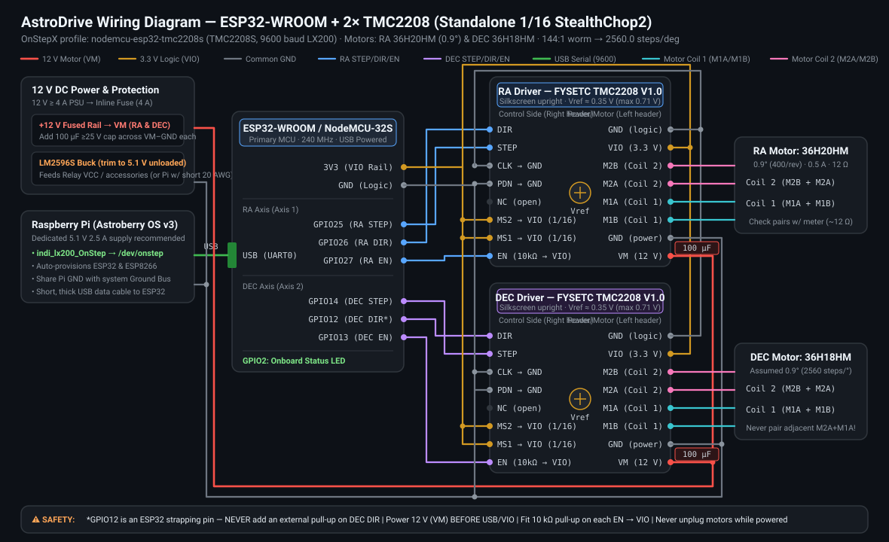
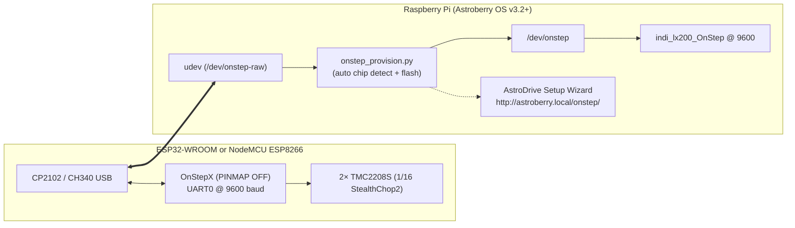

# AstroDrive

Turn a **Raspberry Pi** + **ESP32-WROOM** (or **NodeMCU ESP8266**) + **2× silent TMC2208** stepper drivers into a plug-and-play **OnStepX** telescope mount controller with a built-in browser **Setup Wizard**.

---

## Quick Start (4 Simple Steps)

No manual firmware compiling, no config file editing, and no memorizing Linux commands. After pasting **one** install line, everything else is **Next → Next → Done** in your browser.

### What You Need
- **Raspberry Pi 4 or 5** + **≥ 16 GB microSD card** + good **5.1 V / 2.5 A+** Pi power supply
- **ESP32-WROOM** *(recommended)* or **NodeMCU ESP8266** + a short **data USB cable**
- **2× TMC2208** stepper drivers, **2× stepper motors** (`36H20HM` / `36H18HM`), **12 V ≥ 4 A** power supply + **4 A fuse**, **2× 100 µF** capacitors, **2× 10 kΩ** resistors, and a multimeter

---

### Step 1 — Flash the microSD Card

1. Download **Astroberry OS** (`astroberryos_3.2_debian-trixie-arm64.img.xz`) from **[astroberry.io/download](https://astroberry.io/download/)**.
2. Open **[Raspberry Pi Imager](https://www.raspberrypi.com/software/)** on your computer.
3. Click **Choose Device** → pick your Raspberry Pi model.
4. Click **Choose OS** → scroll down to **Use custom** → pick the file you just downloaded.
5. Click **Choose Storage** → pick your microSD card → click **Next**.
6. When it asks *"Would you like to apply OS customisation settings?"*, click **No** (Astroberry sets itself up automatically).
7. Wait for it to finish, then eject the card.

---

### Step 2 — Turn On the Pi & Connect to Home Wi-Fi

1. Insert the microSD card into the Raspberry Pi and plug in its power. Wait **2 minutes**.
2. On your laptop or phone, join the Wi-Fi network **`astroberry`** (password: **`astroberry`**) — or plug an Ethernet cable into your router.
3. Open your web browser and go to **`http://astroberry.local`**.
4. Log in with username **`astroberry`** and password **`astroberry`**.
5. Follow Astroberry's short welcome screen to pick your **country**, **location**, and connect the Pi to your **home Wi-Fi** (so it has internet access).

---

### Step 3 — Install AstroDrive (One Command)

1. Inside `http://astroberry.local`, open the **Terminal** (or SSH into `astroberry@astroberry.local`).
2. Copy and paste this single line, then press **Enter**:

```bash
curl -fsSL https://raw.githubusercontent.com/0denko/AstroDrive/main/setup.sh | sudo bash
```

3. Wait **3–5 minutes** until you see **`AstroDrive is installed and ready!`** *(if the Pi has no internet yet, it will clearly warn that firmware wasn't downloaded and tell you how to retry)*.
   - This installs AstroDrive, downloads the latest CI-built OnStepX firmware for both ESP32 and NodeMCU (SHA-256 checked against the release manifest), pre-configures KStars/Ekos (`LX200 OnStep` on `/dev/onstep` at `9600` baud), enables safe daily background updates (opt-out), and prints your personal **Setup Wizard link** (which includes your Setup PIN).
   - You can close the Terminal after copying or clicking the link!

---

### Step 4 — Click Through the Setup Wizard in Your Browser

1. Open the **Setup Wizard link** printed at the end of Step 3 (`http://astroberry.local/onstep/?token=...`, or the direct fallback `http://astroberry.local:8090/?token=...`).
   - *(If you open `http://astroberry.local` later without the link, click **`AstroDrive Setup`** in the bottom-right corner and paste the Setup PIN from `/etc/onstep-autoprovision/webui.token` once.)*
2. Click **Next →** through the 5 guided screens:

| Screen | What You Do |
| :--- | :--- |
| **1. System Check** | Confirm the green checkmarks (Pi power, downloaded firmware, Astroberry overlay, KStars/Ekos defaults, AstroDrive version). Fix any yellow/red item with one click, then click **Next**. |
| **2. Wi-Fi & Field Hotspot** *(optional)* | Choose a hotspot name & password (8+ characters) if you want the Pi to create its own Wi-Fi out under dark skies, click **Save**, then **Next** (or skip). |
| **3. Flash Board** | Plug your **bare** ESP32 or NodeMCU into any Pi USB port (no 12 V or motors yet). Click **⚡ Flash OnStepX to This Board** — wait ~30–60 seconds for the green **Controller Ready!** message, then click **Next**. *(Unrelated USB accessories are never overwritten automatically.)* |
| **4. Wiring & Safety** | Unplug USB, pick your board to view the wiring picture right on screen, tick off the 6 safety checks (including setting `Vref ≈ 0.35 V` with motors unplugged), and turn on **12 V power before plugging USB back in**. Click **Next**. |
| **5. Connect & Finish** | Open **KStars → Ekos**, pick **Mount: `LX200 OnStep`**, click **Start** → **Connect**, and test moving the motors on your desk before mounting them on the telescope! |

> **Tip for dark-sky trips (no internet):** If you configured a field hotspot in Wizard Screen 2, join that hotspot on your phone when away from home Wi-Fi, open `http://10.42.0.1/onstep/` (or `http://10.42.0.1:8090/`), and tap **Sync Pi Clock from This Phone/Laptop** so your mount has the exact time.

---

## Quick Troubleshooting

| Problem | Easy Fix |
| :--- | :--- |
| **Board isn't detected or won't flash** | Use a short **data-capable** USB cable (some charging cables have no data wires). On some ESP32 boards, hold the tiny **BOOT** button for 2 seconds right after plugging it in. |
| **Red "Low Raspberry Pi power" warning** | Power the Pi from its own dedicated **5.1 V / 2.5 A+** adapter (not a phone charger or thin USB cable). |
| **Motor buzzes and gets warm instead of turning** | Power off and check the 4 motor wires — pair Coil 1 to `M1A`+`M1B` and Coil 2 to `M2A`+`M2B` (never pair the two middle `M2A`+`M1A` pins together). |
| **Telescope moves twice as far as commanded** | Make sure both `MS1` and `MS2` on each TMC2208 are wired to `VIO` (3.3 V) for 1/16 microsteps. |
| **Can't reach `http://astroberry.local`** | Try `http://astroberry.local:8090` (or `http://10.42.0.1:8090` when connected to the field hotspot). |

---

## Wiring Diagrams

Full step-by-step wiring tables, motor measurements, and power notes are in **[`HARDWARE.md`](HARDWARE.md)**.

### ESP32-WROOM + 2× TMC2208 (Recommended Primary)



### NodeMCU ESP8266 + 2× TMC2208 (Drop-In Backup)


---

## Technical Reference (For Advanced Users)

<details>
<summary><strong>Pinout Table &amp; Motor Settings</strong></summary>

All pin assignments in both firmware profiles match [`HARDWARE.md`](HARDWARE.md) directly:

| Signal | ESP32-WROOM (Primary) | NodeMCU ESP8266 (Backup) | TMC2208 Pin | Notes |
| :--- | :---: | :---: | :---: | :--- |
| **RA STEP** | `GPIO25` | `D1` (`GPIO5`) | RA `STEP` | Boot-safe |
| **RA DIR** | `GPIO26` | `D2` (`GPIO4`) | RA `DIR` | Boot-safe |
| **RA ENABLE** | `GPIO27` | `D0` (`GPIO16`) | RA `EN` | Active LOW — fit **10 kΩ pull-up to `VIO`** (mandatory on NodeMCU `D0`!) |
| **DEC STEP** | `GPIO14` | `D5` (`GPIO14`) | DEC `STEP` | Boot-safe |
| **DEC DIR** | `GPIO12` | `D6` (`GPIO12`) | DEC `DIR` | On ESP32, `GPIO12` is a strapping pin (**no external pull-up!**) |
| **DEC ENABLE** | `GPIO13` | `D7` (`GPIO13`) | DEC `EN` | Active LOW — fit **10 kΩ pull-up to `VIO`** |
| **Logic VCC / GND** | `3V3` / `GND` | `3V3` / `GND` | `VIO` / logic `GND` | **Never feed 5 V into ESP32/ESP8266 pins** |
| **Driver Tie-Offs** | — | — | `MS1`, `MS2` → `VIO`; `PDN`, `CLK` → `GND` | Selects `1/16` StealthChop2 (256× interpolated) + internal clock + standstill power-down |

- **Motors:** `36H20HM-0504A` (`0.9°` = `400` steps/rev, `0.5 A`, `12 Ω`) on RA and `36H18HM` on DEC; at `1/16` microsteps and `144:1` worm → **`2560.0` steps/degree** (if `36H18HM` is `1.8°`, adjust `AXIS2_STEPS_PER_DEGREE` to `1280.0`).
- **TMC2208 `Vref`:** Set to **`~0.35 V`** (`~0.25 A RMS`) with motors unplugged; never exceed **`0.71 V`** (`0.50 A`).

</details>

<details>
<summary><strong>How Auto-Provisioning Works (Architecture)</strong></summary>

1. **`udev`** (`udev/99-onstep-nodemcu.rules`) detects CP2102 (`10c4:ea60`) or CH340 (`1a86:7523`) ESP32/NodeMCU boards, creates `/dev/onstep-raw`, blocks `ModemManager` (`ID_MM_DEVICE_IGNORE=1`), and triggers `onstep-autoprovision@ttyUSBx.service`.
2. **`systemd` + Python** (`scripts/onstep_provision.py`) acquires an exclusive `flock`, verifies no active INDI session holds the port, probes LX200 `:GVP#` / `:GVN#` without DTR/RTS reset, detects blank boards via `esptool --chip auto chip_id`, fetches or compiles the matching OnStepX `.bin`, flashes & verifies it, and **atomically publishes `/dev/onstep`** for `indi_lx200_OnStep`.
3. **Upgrade-safe Astroberry UI overlay:** Nginx proxies `/onstep/` to `onstep-webui.service` (`127.0.0.1:8090`) and injects `/onstep/overlay.js` via `sub_filter` with an APT post-invoke hook (`/etc/apt/apt.conf.d/99-onstep-nginx-overlay`).



</details>

<details>
<summary><strong>Alternative Installs (Raspberry Pi 3B, Vanilla RPi OS, On-Pi Compiler, Pre-baked CI Image)</strong></summary>

- **Raspberry Pi 3B or vanilla Raspberry Pi OS 64-bit:** Flash 64-bit Raspberry Pi OS with Imager (enable SSH + Wi-Fi in OS Customisation), then run the same one-line `setup.sh` command. Open the Setup Wizard at `http://<pi-hostname>.local:8090/`.
- **Enable on-Pi OnStepX compilation** (only needed if you edit `Config.h` directly on the Pi):
  ```bash
  curl -fsSL https://raw.githubusercontent.com/0denko/AstroDrive/main/setup.sh | sudo bash -s -- --with-arduino-cli
  ```
- **Pre-baked downloadable `.img.xz`:** Run **Actions → Build Raspberry Pi Overlay Image (.img.xz) → Run workflow** in GitHub Actions to generate a ready-to-flash `.img.xz` with AstroDrive + firmware baked in.
- **Automated Firmware Builds:** `.github/workflows/build-firmware.yml` compiles both `nodemcu-esp32-tmc2208s` (`esp32:esp32@2.0.17`) and `nodemcu-esp8266-tmc2208s` (`esp8266:esp8266@3.1.2` + `esp8266RfOff` plugin) against upstream `hjd1964/OnStepX` and publishes `.bin` + SHA-256 manifests to [GitHub Releases](https://github.com/0denko/AstroDrive/releases/latest).

</details>

<details>
<summary><strong>Repository Layout &amp; CLI Diagnostics</strong></summary>

```text
AstroDrive/
├── setup.sh                               # One-line curl | sudo bash bootstrap installer
├── install.sh                             # Idempotent RPi installer (--with-arduino-cli, --chroot)
├── HARDWARE.md                            # Full motor, power, Vref, and wire-by-wire guide
├── docs/                                  # ESP32 & NodeMCU ESP8266 SVG wiring schematics
├── .github/workflows/                     # Automated OnStepX firmware & Pi .img.xz builders
├── webui/                                 # Setup Wizard + Dashboard + Astroberry overlay (:8090)
├── scripts/                               # Auto-provisioner, INDI defaults, hotspot, firmware updater
├── systemd/ udev/ nginx/ config/          # System services, udev rules, Nginx overlay, config template
└── firmware/                              # Multi-profile OnStepX overlays (ESP32 + ESP8266 TMC2208S)
```

```bash
# Watch live auto-flash logs
journalctl -fu 'onstep-autoprovision@*'

# Non-resetting LX200 handshake check
/opt/onstep-autoprovision/.venv/bin/python \
  /opt/onstep-autoprovision/scripts/probe_onstep.py --device /dev/onstep

# Refresh cached firmware binaries from GitHub Releases
sudo /opt/onstep-autoprovision/scripts/update_firmware.sh --all
```

</details>
